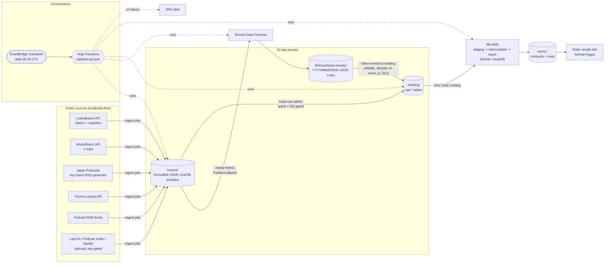

# Music and podcast analytics on an emulated AWS lakehouse

[](https://github.com/rohit91jacob/spotify-music-podcasts-aws/actions/workflows/ci.yml)
[](https://github.com/rohit91jacob/spotify-music-podcasts-aws/actions/workflows/refresh.yml)
[](LICENSE)
[](pyproject.toml)
[](DATA_LICENSE.md)

Spotify-style listening and podcast metrics (artist momentum, genre share, listening sessions,
skip-like short plays, new-release discovery lag, podcast chart movement and longevity by
country, episode release cadence) built from **real public data**:

* **ListenBrainz** (CC0): the actual listens of a fixed, pseudonymised panel of 40 public users,
  replayed as a live event stream through **Kinesis Data Firehose -> S3 -> Apache Iceberg**;
* **MusicBrainz** (CC0 core data): artist, recording and release metadata and genres;
* **Apple Podcasts** top charts for 10 storefronts, the **iTunes Lookup API**, and each charting
  show's own **RSS feed**.

Batch "Glue" jobs turn the landed JSON into typed Iceberg tables behind data-quality gates, dbt
builds tested, contract-enforced marts (DuckDB locally, compiled for Athena in CI), and the whole
flow is a **Step Functions** state machine on an **EventBridge Scheduler** schedule. A results
site is rebuilt daily on GitHub Pages.

**What is real and what is emulated.** The data is real and downloaded at run time. AWS is
**emulated**: moto in-process by default, plus LocalStack and moto_server in CI. The state
machine is interpreted locally from the same ASL file Terraform deploys. Everything under
`infra/` is Terraform that is formatted, validated, linted and scanned, but **not applied**:
no AWS account was used to build or run this repository.

## Contents

1. [Architecture](#architecture)
2. [Results from a recorded run](#results-from-a-recorded-run)
3. [Tech stack](#tech-stack)
4. [Data sources](#data-sources)
5. [Data model](#data-model)
6. [Quickstart](#quickstart)
7. [Local emulator to AWS service](#local-emulator-to-aws-service)
8. [Configuration and CLI](#configuration-and-cli)
9. [Data quality, idempotency and verification](#data-quality-idempotency-and-verification)
10. [Testing and CI](#testing-and-ci)
11. [Infrastructure and cost](#infrastructure-and-cost)
12. [Project structure](#project-structure)
13. [Design rationale](#design-rationale)
14. [Limitations](#limitations)
15. [License](#license)

## Architecture



| Component | Responsibility | Where |
| --- | --- | --- |
| Ingest | Polite HTTP clients (User-Agent, per-host pacing, retries, rate-limit headers); land each response once per UTC day in an immutable, content-addressed bronze zone; pseudonymise users | `src/musicpods/sources/`, `bronze.py`, `http.py` |
| Stream replay | Turn real listens into schema-versioned events with deterministic ids; `PutRecordBatch` to Firehose (500 records / 4 MiB), resending only failed records | `src/musicpods/streaming/replay.py`, `events.py` |
| Firehose sink | Firehose S3 output -> Iceberg `raw.listen_events`: validate, dead-letter bad records, dedupe in batch and against the table, DQ gate, one snapshot per batch | `src/musicpods/streaming/sink.py` |
| Glue-style jobs | Bronze -> 14 typed Iceberg raw tables, every one DQ-gated before the commit; all-or-nothing | `src/musicpods/glue/jobs.py`, `quality/checks.py` |
| dbt | 36 models (staging views, intermediate, contract-enforced marts) and 103 tests; same SQL on DuckDB and Athena | `dbt/` |
| Orchestration | ASL state machine (Parallel ingest, Retry, Catch -> SNS -> Fail) deployed by Terraform; interpreted locally by a small runner; registered with Step Functions + Scheduler in the emulator | `src/musicpods/orchestration/` |
| Glue entrypoint | What a deployed Glue job runs: sync state from S3, run one step against real AWS and the Glue catalog, sync back | `src/musicpods/glue/entrypoint.py` |
| Verification | Reconcile outputs with what the sources publish | `src/musicpods/verify.py`, `dbt/models/marts/verification/` |
| Results site | One static HTML page + `summary.json`, no JavaScript | `src/musicpods/report.py` |
| Infrastructure | KMS, S3, Firehose, Glue jobs and catalog, Athena workgroup, Step Functions, Scheduler, SNS, budget, alarms, GitHub OIDC role | `infra/` |

## Results from a recorded run

From one live run on **2026-10-09** (download, then the whole pipeline on moto), plus a backfill
re-fetch the same evening (see [verification](#data-quality-idempotency-and-verification)). The
daily refresh workflow publishes the current numbers to GitHub Pages.

| Metric | Value |
| --- | --- |
| Listens landed (raw.listen_events, after dedup on event_id) | 89,812 from 40 panel users, 2026-09-11 to 2026-10-09 |
| Listens in the marts (751 duplicate scrobbles excluded) | 89,061 |
| Listens mapped to a MusicBrainz recording | 83.0% |
| Distinct artists heard / with a MusicBrainz genre | 6,686 / 467 (MusicBrainz lookups are capped at the 600 most-played artists) |
| Listening sessions (30-minute gap) | 3,842; median 35.7 min, 90th percentile 175.3 min, 23.2 listens per session |
| Skip-like short plays | 1,503 of 51,264 derivable listens (2.9%) |
| Fresh releases (last 30 days) the panel played | 70; median discovery lag 2.5 days, 71.4% first played within a week |
| Apple Podcasts chart entries | 1,000 (10 storefronts x top 100), 796 distinct shows, 1 daily snapshot so far |
| Shows with feed-based cadence | 60 (21 daily, 18 several per week, 19 weekly, 1 irregular, 1 insufficient history) |
| Episodes parsed from RSS | 38,062 |
| dbt build | 139 nodes (36 models, 103 tests) passed |
| Settled user-days matching ListenBrainz's published daily counts | **425 of 426** exactly (35,674 vs 35,667 listens) |

Artist momentum for the week of 2026-09-28: the largest gains were Magdalena Bay (+498 listens),
Taylor Swift (+416) and Playboi Carti (+405). With 40 users these are panel movements, not
market trends.

## Tech stack

| Tool | Version | Role |
| --- | --- | --- |
| Python | 3.12 (3.13 on Glue 6.0) | runtime |
| uv | 0.10 | dependencies (`uv.lock`) |
| boto3 / moto | 1.43.110 / 5.2.3 | AWS SDK / in-process AWS emulator (S3, Firehose, Step Functions, Scheduler) |
| LocalStack | 4.4.0 (CI only) | second emulator for the endpoint path |
| PyIceberg (+ pyiceberg-core) | 0.12.0 (0.10.1) | Iceberg tables: SQLite catalog locally, Glue catalog when deployed |
| PyArrow | 26.0.0 | typed batches |
| DuckDB | 1.5.6 | local warehouse (Athena stand-in), DQ check engine |
| dbt-core / dbt-duckdb / dbt-athena-community | 1.12.5 / 1.11.0 / 1.11.1 | transformations, contracts, tests |
| requests, defusedxml | 2.34.2, 0.7.1 | HTTP; safe RSS parsing (no entity expansion) |
| Terraform / AWS provider | 1.16.5 / ~> 6.68 | infrastructure as code |
| tflint (+ aws ruleset 0.49.0), checkov | 0.64.0, 3.3.26 | IaC linting and security scanning |
| ruff, pytest, pre-commit, gitleaks | 0.16.10, 9.1.1, 4.6.2, 8.30.1 | quality gates |

## Data sources

| Source | Data used | Licence | Refresh cadence (source / ours) | Known gaps |
| --- | --- | --- | --- | --- |
| [ListenBrainz API](https://listenbrainz.readthedocs.io/en/latest/users/api/index.html) | listens of the panel; per-user daily activity and top artists; sitewide top artists; fresh releases | CC0 1.0 | listens immediately; statistics daily for new listens, 1st and 15th of the month for older listens ([intervals](https://listenbrainz.readthedocs.io/en/latest/general/data-update-intervals.html)) / daily, incremental by per-user cursor | a panel of 40 public users is not representative of anyone; 17% of listens are not mapped to MusicBrainz; the listens endpoint is often slow |
| [MusicBrainz API](https://musicbrainz.org/doc/MusicBrainz_API) | artists (type, country, tags), recordings (length), release groups (type, first-release date), genre list | core CC0; tags (genre associations) CC BY-NC-SA 3.0 | live / ids looked up once and refreshed after 30 days, at 1 request per second | only the most-played 600 artists, 3,000 recordings and 2,000 release groups (+200 fresh-release groups) are looked up; partial dates (`2019`) are kept raw and excluded from age buckets |
| [Apple Podcasts top charts](https://rss.marketingtools.apple.com/) | Top Shows (100) for us, gb, ca, au, in, ie, de, fr, br, jp | Copyright Apple; not redistributed | Apple publishes no cadence (the feed's `updated` field is the response time) / one snapshot per storefront per UTC day | movement and longevity need several days of snapshots; the recorded run has one |
| [iTunes Lookup API](https://performance-partners.apple.com/search-api) | feed URL, genre, episode count, latest release date | Apple API terms (no artwork or previews used) | live / daily per storefront, paced below ~20 calls/min | `trackCount` and `releaseDate` lag or disagree with feeds for some shows (see verification) |
| Podcast RSS feeds | publish dates, durations, episode type (guid hashed; titles not stored) | each publisher | live / daily for the top 10 shows per storefront (60 feeds) | many large shows publish only recent episodes in their feed |
| Last.fm, Podcast Index, Spotify Web API (optional) | global top artists; independent episode counts; catalogue metadata only | each API's terms | daily when the secret is set | not used in the recorded run (no keys). Spotify: since November 2024 new apps cannot call audio-features or recommendations, so nothing depends on them |

The committed fixtures are 6 real ListenBrainz users with their MusicBrainz entities (CC0, plus
CC BY-NC-SA tags), and **simulated** podcast data. Apple's data cannot be redistributed, so the
podcast fixtures are generated with a fixed seed and every show is named `SYNTHETIC Show NN`.
Licences, attribution and privacy measures: [DATA_LICENSE.md](DATA_LICENSE.md).

**How the listener panel is chosen** (deterministic, `src/musicpods/sources/listenbrainz.py`):

1. Take ListenBrainz's sitewide top artists of the week and keep every third (to reach beyond the
   head of the chart).
2. Collect each seed artist's top listeners.
3. Order candidates by a hash of their name and keep the first 40 whose published activity is
   plausible for one person (no day above 480 listens, some activity this week).

The panel is persisted so week-over-week metrics compare the same people. User names never
leave the ingest step: records carry a salted SHA-256 `user_key`, and logged errors are redacted.

## Data model

Full column-level documentation: [docs/data_dictionary.md](docs/data_dictionary.md) (generated
from the dbt contracts). Layers: `raw` (Iceberg) -> `staging` (views) -> `intermediate` -> `marts`.

| Model | Grain | Answers |
| --- | --- | --- |
| `fct_listens` | one non-duplicate listen | session id, short-play basis and flag, artist and genre |
| `fct_listening_sessions`, `mart_listening_sessions_daily` | session / UTC day | session length, listens, short plays |
| `dim_artist` | artist (MBID or credited name) | MusicBrainz metadata, primary genre |
| `mart_artist_momentum` | ISO week x artist | listens vs the previous week, momentum rank, complete/comparable-week flags |
| `mart_genre_share` | week x primary genre | share of listens |
| `mart_short_plays_weekly` | week x artist | skip-like short-play rate where derivable |
| `mart_new_release_share` | week x release-age bucket | how much listening goes to new releases |
| `mart_release_discovery_lag` | fresh release group | days from release to first panel play, first-week listens |
| `dim_podcast` | show | Apple metadata, first/last charted |
| `mart_podcast_chart_movement` | snapshot x storefront x rank | rank change and movement class |
| `mart_podcast_chart_longevity` | storefront x show | snapshots on chart, current streak, best rank |
| `mart_podcast_cross_country` | show | storefronts charting it now |
| `mart_episode_cadence` | show | median gap between recent episodes, cadence class |
| `ver_*` | see [verification](docs/verification.md) | reconciliation with published figures |

**Sessionisation.** A new session starts after more than `session_gap_minutes` (30) without a new
listen.

**Short plays.** A listen counts as a short play when it played for less than half the track:

* measured directly where the client reports playback time (`ms_played` from Spotify history
  imports);
* otherwise inferred when the next listen in the same session started before half the track had
  elapsed, with gaps under 30 s treated as timestamp collisions from batch imports, not plays.

Clients only submit a listen after half the track or 4 minutes by default, so most real skips
never reach ListenBrainz.

## Quickstart

Prerequisites: [uv](https://docs.astral.sh/uv/) (installs Python 3.12), git. `make` is optional;
every target is a plain `uv run` command (see `make help` / the `Makefile`).

```bash
git clone https://github.com/rohit91jacob/spotify-music-podcasts-aws.git
cd spotify-music-podcasts-aws
uv sync --frozen

# 1. Whole pipeline on the committed fixtures: no network, AWS emulated in-process (~1 min)
uv run musicpods --data-dir data/fixtures run --from-dir tests/fixtures/bronze --run-date 2026-10-09 --dbt-target ci
uv run musicpods --data-dir data/fixtures verify
uv run musicpods --data-dir data/fixtures report --out site     # open site/index.html

# 2. The same on live data (MusicBrainz at 1 req/s: about 15-30 minutes the first time)
uv run musicpods run
uv run musicpods verify --out site/verification.json && uv run musicpods report --out site

# 3. Explore
uv run musicpods sql --list
uv run musicpods sql "SELECT week_start, artist_name, wow_change FROM marts.mart_artist_momentum WHERE is_comparable_week ORDER BY week_start DESC, momentum_rank LIMIT 10"
```

Against LocalStack or moto_server instead of in-process moto:

```bash
uv run moto_server -p 5000 &          # or: docker run -p 4566:4566 localstack/localstack:4.4.0
export MUSICPODS_AWS_ENDPOINT_URL=http://127.0.0.1:5000 AWS_ACCESS_KEY_ID=test AWS_SECRET_ACCESS_KEY=test
uv run pytest -m integration tests/integration
```

## Local emulator to AWS service

| In this repo (local / CI) | In AWS (Terraform in `infra/`) |
| --- | --- |
| moto `firehose` in-process; LocalStack / moto_server in CI | Kinesis Data Firehose (Direct PUT -> S3, GZIP, SSE-KMS) |
| moto `s3`, mirrored to `data/s3/` | S3 lake bucket (versioned, SSE-KMS, TLS-only, access-logged, lifecycle) |
| PyIceberg `SqlCatalog` (SQLite) + local warehouse | PyIceberg `GlueCatalog`: AWS Glue Data Catalog + Iceberg on S3 |
| Functions in `musicpods.glue.jobs` / `orchestration.steps`, run in-process | One AWS Glue 6.0 job per step running `glue/entrypoint.py` |
| DuckDB (`dbt-duckdb`) | Amazon Athena workgroup (`dbt-athena`; compiled in CI) |
| `musicpods.orchestration.runner` interpreting `pipeline.asl.json`; moto Step Functions + Scheduler for registration | AWS Step Functions (same ASL file via `templatefile`) + EventBridge Scheduler |
| `ops/alerts.jsonl` | SNS topic (KMS-encrypted) + CloudWatch alarms + AWS Budgets |
| `.env` / repository secrets | AWS Secrets Manager (`musicpods/lastfm`, ...) read by the ingest job |
| GitHub Pages results site | (same) |

## Configuration and CLI

All settings are `MUSICPODS_*` environment variables with safe defaults; see
[.env.example](.env.example). Invalid values fail fast with exit code 2.

```
musicpods ingest   [--source S] [--from-dir DIR] [--lb-backfill]   download (or import fixtures) into bronze
musicpods replay   [--full] [--limit N] [--duplicate-every N]      listens -> Kinesis Data Firehose
musicpods sink                                                       Firehose S3 output -> Iceberg raw.listen_events
musicpods glue     [--job NAME]                                      bronze -> DQ gate -> Iceberg raw tables
musicpods load | dbt <args>                                          raw -> DuckDB; dbt (loads raw first)
musicpods run      [--from-dir DIR] [--run-date D] [--full-replay]   the whole state machine
musicpods asl      validate | render | register                      check / print / register in the emulator
musicpods verify | report --out site | sql "<query>" | maintain       reconcile; site; ad-hoc SQL; expire snapshots
```

Exit codes: 0 ok, 1 unexpected error, 2 configuration, 3 data-quality gate, 4 dbt error.

## Data quality, idempotency and verification

* **Gates between layers.** Every raw table is checked before its Iceberg commit (not null,
  unique keys, ranges, UUID formats, ISO country codes, timestamps not in the future, minimum
  rows). An `error` failure stops the step with exit code 3 and leaves the previous snapshot in
  place; `warn` checks are logged to `ops/dq_results.jsonl`. dbt gates the marts with 103
  tests, including singular tests: every listen belongs to exactly one session, genre shares sum
  to 1, each chart snapshot is a gapless ranking, and the session gap is respected.
* **Exactly-once rows over at-least-once delivery.** `event_id` is a hash of
  (user, timestamp, message id). The sink drops duplicates within a batch and against the table,
  and moves its cursor only after the commit. On the live data, a full re-fetch re-sent 111,950
  events; the sink appended only the 175 that were actually missing.
* **Reruns.** A second `musicpods run` on the same inputs replays 0 events, appends 0 rows and
  leaves every mart byte-for-byte identical. This is asserted in `tests/e2e`, in CI, and after a
  deliberate DQ failure.
* **Verification** ([docs/verification.md](docs/verification.md)) against figures the sources
  publish:

  | Check | Result (live run) |
  | --- | --- |
  | Listens per user and UTC day vs ListenBrainz's listening-activity statistics (settled days) | 425 of 426 user-days exact |
  | Each user's top-10 artists vs ListenBrainz's top-artist statistics | 93 of 324 pairs exact, 177 within 20% (a weak check; causes discussed) |
  | Episodes in each RSS feed vs Apple's `trackCount` | 29 of 60 equal; 28 feeds list fewer (feeds publish recent episodes only) |
  | ListenBrainz fresh-release dates vs MusicBrainz release-group dates | 232 of 232 equal (both derive from MusicBrainz; checks parsing and joins) |

  The daily check found a real pagination bug (listens sharing a timestamp at a page boundary
  were skipped). It was fixed, regression-tested and backfilled, which took exact days from 414
  to 425.

## Testing and CI

```bash
uv run ruff check . && uv run ruff format --check .
uv run pytest tests/unit                 # 65 tests, moto in-process, HTTP mocked
uv run pytest -m e2e tests/e2e           # whole pipeline on fixtures, reruns, full replay, DQ failure
uv run pytest -m integration tests/integration   # needs MUSICPODS_AWS_ENDPOINT_URL
```

Locally, 73 unit and e2e tests (65 + 8) pass with 86% line coverage, and the integration test passes
against moto_server.

[`ci.yml`](.github/workflows/ci.yml) (actions pinned by commit SHA):

| Job | What it does |
| --- | --- |
| lint | ruff, pre-commit (whitespace, YAML/TOML/JSON, files under 300 KB, private keys, gitleaks) |
| unit | ASL validation + unit tests with coverage |
| pipeline | `musicpods run` on fixtures twice (rerun is a no-op), standalone `dbt build`, verify, report, e2e tests, dbt docs |
| dbt-athena | `dbt compile --target athena` with dbt-athena, no AWS connection |
| terraform | `fmt -check`, `init -backend=false`, `validate`, tflint, checkov |
| emulator-moto-server, emulator-localstack | Firehose -> S3 -> Iceberg-on-S3 round trip against a network AWS endpoint |

Other workflows: [`refresh.yml`](.github/workflows/refresh.yml) runs daily at 06:15 UTC on live
data and publishes the site to GitHub Pages, opening an issue when a scheduled run fails.
[`keepalive.yml`](.github/workflows/keepalive.yml) keeps schedules enabled.
[`deploy.yml`](.github/workflows/deploy.yml) is manual, runs only when the `AWS_DEPLOY_ROLE_ARN`
repository variable is set, and authenticates with OIDC (no static keys). It has never been run.

## Infrastructure and cost

`infra/` holds a root module and eight child modules: `kms`, `lake`, `catalog`, `streaming`,
`glue_jobs`, `orchestration`, `monitoring` and `github_oidc`.

* **Encryption.** One customer-managed KMS key (rotation on) for S3, Firehose, Glue (logs,
  bookmarks, S3), the catalog, Step Functions, SNS and CloudWatch Logs.
* **Least-privilege IAM.** Each role is scoped to its prefixes and resources: Firehose writes
  only `firehose/`, Glue reads `firehose/` and writes `bronze/`, `state/` and `iceberg/`. Service-role
  trust policies are restricted to this account; the GitHub OIDC role is restricted to one
  repository and environment.
* **Buckets.** Public access blocks, TLS-only bucket policies, versioning, access logs, and
  lifecycle rules (Firehose raw data moves to IA after 30 days; Athena results expire after 7).
* **Guardrails.** An Athena per-query scan limit of 1 GiB, Glue job timeouts with
  `max_concurrent_runs=1`, a monthly AWS Budget on the `project` tag (default 25 USD; alerts at
  80% actual and 100% forecast), and alarms for a failed execution, a missing daily run and
  Firehose data freshness.
* **Checks.** `terraform validate`, tflint and checkov all pass (252 checks). The 13 inline checkov
  skip annotations (17 skipped results, as some cover `for_each` instances) each give a
  reason: for example, key policies cannot name their own ARN, and access-log
  buckets cannot use SSE-KMS.

**Cost notes.** These are estimates, not measured: nothing was deployed.

* Data is tiny: about 23 MB of bronze per first run and 14 MB of Iceberg.
* The dominant cost would be Glue. Each step is a 2-DPU Glue 6.0 Spark job, billed with a
  1-minute minimum, and the daily run has 9 steps. At about 3 minutes each, that is
  9 x 2 DPU x 0.05 h x 0.44 USD = roughly 0.40 USD a day.
* Athena scans are kilobytes to megabytes; Firehose ingests a few thousand small records per day after the first run.
* Moving the light steps to Lambda (or one container task) would cut cost by an order of
  magnitude. A Spark job type is used only because Glue's Python shell jobs stop at Python 3.9.

## Project structure

```
src/musicpods/
  sources/        listenbrainz, musicbrainz, podcasts (charts, lookup, RSS), optional (key-gated)
  streaming/      events (schema v1), replay (-> Firehose), sink (-> Iceberg)
  glue/           jobs (bronze -> raw), schemas (Arrow), entrypoint (deployed Glue jobs)
  orchestration/  pipeline.asl.json, runner (local ASL interpreter), steps
  quality/        DQ checks and gates
  bronze.py http.py lakehouse.py warehouse.py verify.py report.py cli.py config.py aws.py
dbt/              staging/ intermediate/ marts/{music,podcasts,verification}/ tests/ macros/
infra/            main.tf + modules/{kms,lake,catalog,streaming,glue_jobs,orchestration,monitoring,github_oidc}
tests/            unit/ e2e/ integration/ fixtures/bronze/ (real LB + MB, simulated podcasts)
scripts/          build_fixtures.py, make_synthetic_podcast_fixtures.py, gen_data_dictionary.py
docs/             data_dictionary.md, runbook.md, verification.md
```

## Design rationale

A few constraints drove the design. The data must be real and public, and the daily refresh must
run on a GitHub-hosted runner without credentials, carrying its state between runs in the Actions
cache. No AWS account is used, so every AWS call has to work against an emulator, and the
Terraform is validated and scanned but never applied. Apple's charts and publishers' feeds cannot
be redistributed, so CI has no real podcast data to run on. The sources are rate-limited
(MusicBrainz allows one request per second), which caps how much metadata a run can fetch. And
every step must be safe to rerun, because rerunning is how a failed run is recovered.

### Architecture decisions

| Decision | Why | Alternatives considered | Trade-off accepted |
| --- | --- | --- | --- |
| Replay real ListenBrainz listens as the event stream (`src/musicpods/streaming/replay.py`) | The stream is real user behaviour, with real timestamps, duplicate scrobbles and client quirks, and it can be reconciled with figures ListenBrainz publishes. `--duplicate-every` exists only as a drill for the dedup path; it is off by default | A synthetic event generator; loading listens in batch, with no stream at all | Event time is historical: "live" means a replay, paced by `MUSICPODS_REPLAY_SPEEDUP` (0 sends as fast as possible), and volume is bounded by the 40-user panel |
| Firehose -> S3 -> a commit job (`listen-events-to-iceberg`), not Firehose's native Iceberg destination | Validation, the dead-letter file (one reason per record) and exactly-once dedup stay in code that the emulators and tests can run (`src/musicpods/streaming/sink.py`) | Firehose's Iceberg destination; Kinesis Data Streams with a Lambda or Flink consumer | A micro-batch hop: listens land after Firehose's 60 s buffer plus a job run (the state machine waits 90 s), and there is one more job to operate |
| Deterministic `event_id` plus an anti-join: at-least-once delivery, exactly-once rows | `event_id` hashes (user, timestamp, `recording_msid`), so a resent listen keeps its id (`src/musicpods/streaming/events.py`). The sink drops duplicates within the batch and against the table, then moves its cursor only after the Iceberg commit, so a crash in between is harmless | Relying on delivery semantics (Firehose delivers at least once, and backfills and `--full` replays resend on purpose); an Iceberg upsert or `MERGE` on `event_id` | Every commit reads the table's whole `event_id` column: trivial at about 90,000 rows, but linear in table size |
| Bronze is the history: the 14 batch raw tables and every dbt model are rebuilt in full on each run | Bronze (`src/musicpods/bronze.py`) is immutable and content-addressed, with a sha256 manifest; landing the same content again is a no-op, and the first version of each file per day wins. Each raw table is rebuilt from all of bronze in one atomic Iceberg commit (`src/musicpods/glue/jobs.py`), so reruns are trivial and rule changes retroactive. Only `raw.listen_events` is appended to | Daily `MERGE` into the raw tables; dbt incremental models | Rebuild cost grows with history (every chart snapshot, every MusicBrainz fetch), which stays cheap at tens of MB; a bad payload stays in bronze until it is moved aside ([runbook](docs/runbook.md#data-quality-failure)) |
| Data-quality gates before every commit, all-or-nothing (`src/musicpods/quality/checks.py`) | An `error` check stops the step with exit code 3 before anything is committed: `build-raw-tables` checks all 14 tables before writing any, and the sink checks each batch before appending it. 103 dbt tests then gate the marts. Gated steps have no Retry, so a failure goes straight to Catch -> SNS | Great Expectations or Soda; AWS Glue Data Quality rules; dbt tests alone, which run only after raw data is committed | The checks are hand-written SQL predicates that DuckDB evaluates over the Arrow batch, with no profiling or UI; one failing raw table holds back the whole raw refresh, and the marts stay at the last good build until it is fixed |
| One ASL file for both worlds (`src/musicpods/orchestration/pipeline.asl.json`) | Terraform renders it for Step Functions, and the local runner interprets it (Parallel, Retry, Catch, Fail), so local runs and CI exercise the deployed control flow, including the alert path. Unit tests keep the ASL tasks, the local steps and the Terraform job list identical | Airflow (MWAA), Dagster or Prefect; Step Functions Local | The runner covers a subset of ASL (no Choice or Map), runs Parallel branches one after another, skips Wait states and writes the SNS alert to `ops/alerts.jsonl` |
| Real fixtures where the licence allows, simulated and labelled elsewhere | CI runs the whole pipeline with no network. The 6 committed ListenBrainz users and their MusicBrainz entities are real; Apple's data cannot be redistributed, so the podcast fixtures come from a seeded generator, every show is named `SYNTHETIC Show NN`, and the results site says so when built from them | Recorded HTTP responses (would commit Apple's data); leaving podcasts out of CI | The podcast path is tested on the real payload shapes but not on real-world quirks, and the RSS-vs-Apple episode check agrees with itself by construction |
| Pseudonymise at ingest and land only what is used (`src/musicpods/sources/listenbrainz.py`) | Listens are public, but landed records carry a salted SHA-256 `user_key` instead of the user name, errors are redacted before they reach public CI logs, and only an allowlist of client fields is kept. RSS guids are hashed and titles are not stored | Landing user names; an unsalted hash, which anyone could recompute from public user names | The panel file in `ops/` keeps user names (the API needs them), so the data directory is never published; the salt must survive between runs, or every pseudonym changes |
| Reconcile on settled days only (`ver_user_daily_listens`, `stats_settle_days: 3`) | ListenBrainz computes its statistics from a listens snapshot that lags, so comparing the lagging tail would report noise as error. The tail is still reported, separately ([verification](docs/verification.md)) | Comparing every published day; tolerance bands instead of exact matches | A problem in the newest 3 days of a published range shows up only once a later statistics snapshot has settled those days |

### Stack choices

| Layer | Choice | Why this | Why not the alternatives |
| --- | --- | --- | --- |
| Runtime and packaging | Python 3.12 (`requires-python` admits the 3.13 that Glue 6.0 runs); uv 0.10 with `uv.lock` | PyIceberg, PyArrow, DuckDB and dbt are all Python, so ingest, sink, jobs, checks and the Glue entrypoint ship as one package and one wheel. `uv sync --frozen` reproduces the locked environment on a laptop and in CI, and uv installs Python itself | Poetry or pip-tools: they lock too, but need an existing Python and resolve more slowly |
| AWS SDK and emulators | boto3 1.43.110; moto 5.2.3 in-process by default; moto_server and LocalStack 4.4.0 in CI | moto is a runtime dependency on purpose: by default every SDK call runs in-process (`src/musicpods/aws.py`), so a run needs no Docker and no account. `MUSICPODS_AWS_ENDPOINT_URL` sends the same calls to a network endpoint, which CI tests on two different emulators; in a deployed Glue job they go to AWS | LocalStack alone: needs Docker, and newer images need an auth token (hence the pin); a real AWS account: costs money, and none is used |
| Table format and catalog | Apache Iceberg through PyIceberg 0.12.0 (pyiceberg-core 0.10.1); SQLite `SqlCatalog` locally, `GlueCatalog` when deployed (`src/musicpods/lakehouse.py`) | Atomic commits mean readers see the previous table or the new one, never half of a rebuild; hidden partitioning (`day(listened_at)`) and snapshot expiry (the `maintenance` step) come with the format. PyIceberg writes Iceberg from plain Python with no Spark or JVM, and Athena queries Iceberg tables in the Glue catalog | Delta Lake or Hudi: Athena can only read them, and the dbt project materialises Iceberg (`+table_type: iceberg`); plain Parquet: no atomic replace or snapshot history |
| Columnar batches | PyArrow 26.0.0 | A typed Arrow schema per raw table (`src/musicpods/glue/schemas.py`) is the contract between landed JSON and Iceberg; a batch goes from its builder to the DuckDB checks to the PyIceberg commit without leaving Arrow | pandas: nullable integers become floats and nested lists become objects unless every dtype is pinned, and it adds a conversion before each commit |
| Local warehouse and check engine | DuckDB 1.5.6; Amazon Athena (engine version 3, 1 GiB per-query scan limit) when deployed | In-process and file-based, with no server to start. `load_raw` copies each raw table's current snapshot into DuckDB, the role the Glue catalog plays for Athena (`src/musicpods/warehouse.py`), and the same engine runs the DQ predicates over Arrow batches | PostgreSQL: a server to run and load; Spark, locally or on Glue: a JVM for a few MB of data; Athena itself: needs an account |
| Transformations | dbt-core 1.12.5 with dbt-duckdb 1.11.0 (run) and dbt-athena-community 1.11.1 (compiled in CI, never run) | Tests, enforced contracts on the marts, docs and lineage in one tool; one project for both engines through dispatch macros (`dbt/macros/cross_db.sql`) and schema names that match the Glue databases. Generic tests are defined in the repo, so `dbt build` downloads no packages | SQL run from Python: tests, contracts, docs and lineage would all be home-made; Spark SQL on Glue: a JVM in every local run |
| HTTP and parsing | requests 2.34.2 behind a small client (`src/musicpods/http.py`); defusedxml 0.7.1 | Synchronous calls suit sources that must be paced anyway (MusicBrainz 1 req/s, iTunes about 20 calls/min). The client adds per-host pacing, `Retry-After`, ListenBrainz's rate-limit headers and a streamed body cap. RSS feeds are untrusted XML, and defusedxml forbids entity declarations and external references | httpx or aiohttp: concurrency buys nothing under per-host pacing; the standard-library XML parsers: entity-expansion safety depends on the bundled expat version |
| Stream transport | Kinesis Data Firehose, Direct PUT -> S3 (SSE-KMS) | Fully managed, with no shards or consumers to run, and it buffers records into S3 objects that a batch job commits. The producer keeps to the `PutRecordBatch` limits (500 records, 4 MiB) and resends only failed records | Kinesis Data Streams: a consumer to write and run for a few thousand events a day; Amazon MSK: a Kafka cluster billed around the clock |
| Batch compute | AWS Glue 6.0 (Python 3.13): one job per step, 2 G.1X workers, all running `src/musicpods/glue/entrypoint.py` | Every step is the same `glue:startJobRun.sync` task, with the Glue catalog, a KMS security configuration and CloudWatch logs built in, deployed from the package wheel with no image to build. The entrypoint syncs `bronze/` and `state/ops/` with S3 around the step, so the functions that run in-process locally run unchanged | Glue Python shell: stops at Python 3.9; Lambda: cheaper for the light steps ([cost notes](#infrastructure-and-cost)), but its 15-minute limit is tight for an API-paced first ingest; one container task: cheaper too, but an image to build and push |
| Orchestration and schedule | Step Functions (Standard) and EventBridge Scheduler in `infra/`; the same ASL interpreted by `src/musicpods/orchestration/runner.py` locally and in `refresh.yml` | ASL is a declarative file that Terraform and a small interpreter can both read, with native Glue `.sync` tasks, Retry/Catch and an SNS failure path; Scheduler adds a flexible window, retries and KMS. With nothing deployed, `refresh.yml` runs the definition daily at 06:15 UTC on a GitHub-hosted runner | Airflow on MWAA: an always-on environment for one 9-step daily run, and a Python DAG the local runner could not share; Dagster or Prefect: another service to host |
| Serving | One static HTML page and `summary.json` on GitHub Pages (`src/musicpods/report.py`), no JavaScript | Free to host, with nothing to keep running; rebuilt daily from the marts, and it opens from disk too. A deployment would keep it | QuickSight or Superset: an account or a server for a handful of small tables; a JavaScript dashboard: more code to maintain for the same tables |
| Infrastructure as code | Terraform 1.16.5 with the AWS provider 6.68.0 (`~> 6.68`): a root module and eight child modules, S3 backend with native locking; tflint 0.64.0 (aws ruleset 0.49.0) and checkov 3.3.26 | One module per concern; `templatefile` deploys the very ASL file the local runner executes. CI runs `fmt`, `validate` with `-backend=false`, tflint and checkov (252 checks pass) without an account | AWS CDK or CloudFormation: equally able to describe this stack; Terraform keeps it in declarative HCL with no synth step, and with a plan to review before any apply |
| Code quality and CI | ruff 0.16.10, pytest 9.1.1, pre-commit 4.6.2, gitleaks 8.30.1; GitHub Actions pinned by commit SHA; OIDC for the manual deploy | ruff lints, sorts imports and formats in one tool; pytest markers (`e2e`, `integration`) keep the end-to-end and emulator-bound tests out of the unit run; pre-commit caps files at 300 KB (keeping fixtures small) and scans for private keys and secrets. The deploy role trusts one repository and environment, so there are no static AWS keys | flake8, isort and black: three tools for what ruff does alone; access keys as repository secrets: a standing credential that can leak |

### What would change in production

* **A first real deployment.** Nothing here has run on AWS (see [Limitations](#limitations)).
  Applying the Terraform and starting one execution in a sandbox account, as the
  [runbook](docs/runbook.md#deploying-to-aws-not-done-in-this-repository) describes, would be the
  first real test of the Glue entrypoint, the `GlueCatalog` branch of `src/musicpods/lakehouse.py`
  and dbt-athena.
* **Lighter compute.** Lambda or one container task for the light steps instead of a 2-DPU Spark
  job each, which the [cost notes](#infrastructure-and-cost) put an order of magnitude cheaper,
  keeping a Spark job type only for steps whose data outgrows one worker.
* **Firehose's native Iceberg destination** in place of the commit job. The `event_id` dedupe that
  backfills and `--full` replays rely on would then move downstream, into dbt staging or a
  scheduled Iceberg `MERGE`.
* **Incremental processing at volume.** Full rebuilds from bronze and the sink's whole-column
  anti-join suit tens of MB. At scale the raw jobs would merge only new bronze partitions, the
  sink would compare only the `day(listened_at)` partitions its batch touches, and the large dbt
  models would become incremental (dbt-athena supports `merge` on Iceberg tables).
* **Scheduling, state and alerts in AWS.** The live refresh runs on a GitHub Actions cron and keeps
  its cursors as JSON files in the Actions cache, which is evicted after 7 days without use (the
  panel and chart history then restart); deployed Glue jobs sync the same files to
  `s3://<lake>/state/ops/` around each run. In production EventBridge Scheduler would start the
  state machine (already in `infra/`), cursors would move to a store with conditional writes such
  as DynamoDB, and failures would alert through SNS and the CloudWatch alarms instead of a GitHub
  issue.
* **Population instead of a panel.** The panel is 40 users and MusicBrainz lookups are capped (600
  artists, at one request per second). A population-level version would load the ListenBrainz and
  MusicBrainz data dumps rather than page through the APIs.

## Limitations

* **Emulated cloud only.** Nothing ran on AWS. The Glue entrypoint, the Glue catalog path and
  dbt-athena are exercised by unit tests and compilation, not against real services. The
  LocalStack job is written for CI and has not been run locally (no Docker here). The same
  endpoint test was run locally against moto_server.
* **Sample, not population.** 40 public ListenBrainz users, chosen by a documented rule, skew
  towards heavy, technical listeners. Rankings are panel facts, not market facts.
* **Podcast history starts at the first run.** Apple's feed has no history, so movement and
  longevity accumulate one snapshot per day. The recorded run has one, so every entry is a
  baseline.
* **Metadata coverage is capped.** Genres come from at most 600 MusicBrainz artists (467 tagged),
  so 33% of the week's listens fall in `unknown` or `unmapped`.
* **Short plays are a lower bound.** Most skips never become listens. The `next_listen` inference
  depends on client behaviour.
* **Top-artist reconciliation is weak** (93 of 324 exact), for reasons explained but not fully
  resolved in [docs/verification.md](docs/verification.md).
* **Local Windows runs** print harmless faulthandler dumps from `platform._wmi_query` during
  imports. They do not affect results.
* **One unexplained local crash.** One sampled live run on Windows exited with code 127 and no
  traceback in the Iceberg sink step; rerunning completed it and the crash did not reproduce
  ([runbook](docs/runbook.md#unexplained-local-crash-windows)).

## License

Code: MIT ([LICENSE](LICENSE)). Data: see [DATA_LICENSE.md](DATA_LICENSE.md). ListenBrainz and
MusicBrainz data by the MetaBrainz Foundation and contributors; podcast charts and metadata by
Apple. Not affiliated with Spotify, Apple, ListenBrainz or MusicBrainz.
